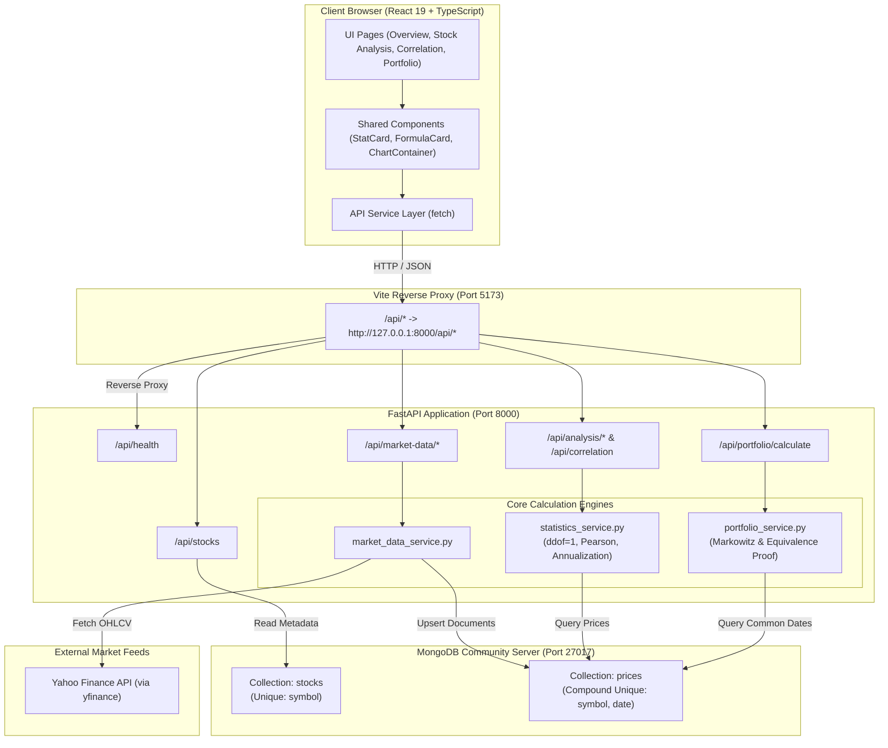

# Stock Market Risk & Correlation Analyzer

<div align="center">

[](https://fastapi.tiangolo.com)
[](https://www.python.org/)
[](https://react.dev/)
[](https://www.typescriptlang.org/)
[](https://tailwindcss.com/)
[](https://www.mongodb.com/)
[](#21-license)
[](#14-testing)

**A rigorous computational finance and portfolio risk analytics platform for the National Stock Exchange of India (NSE).**

[Explore Features](#5-features) • [System Architecture](#8-system-architecture) • [Getting Started](#10-getting-started) • [Mathematical Foundations](#6-mathematical-foundations-and-statistical-rigor) • [API Reference](#12-api-documentation)

</div>

---

## Table of Contents

- [1. Project Overview](#1-project-overview)
- [2. About the Project](#2-about-the-project)
  - [2.1 Problem Statement](#21-problem-statement)
  - [2.2 Proposed Solution](#22-proposed-solution)
  - [2.3 Core Objectives](#23-core-objectives)
- [3. Approved Stock Universe](#3-approved-stock-universe)
- [4. Visual Presentation and Interface Tour](#4-visual-presentation-and-interface-tour)
- [5. Features](#5-features)
- [6. Mathematical Foundations and Statistical Rigor](#6-mathematical-foundations-and-statistical-rigor)
  - [6.1 Daily Simple Arithmetic Returns](#61-daily-simple-arithmetic-returns)
  - [6.2 Sample Mean Daily Return](#62-sample-mean-daily-return)
  - [6.3 Unbiased Sample Variance (Bessel's Correction)](#63-unbiased-sample-variance-bessels-correction)
  - [6.4 Sample Standard Deviation and Annualized Volatility](#64-sample-standard-deviation-and-annualized-volatility)
  - [6.5 Sample Covariance and Pearson Correlation](#65-sample-covariance-and-pearson-correlation)
  - [6.6 Markowitz Two-Stock Portfolio Variance](#66-markowitz-two-stock-portfolio-variance)
  - [6.7 Mathematical Equivalence Proof Validation](#67-mathematical-equivalence-proof-validation)
- [7. Technology Stack](#7-technology-stack)
- [8. System Architecture](#8-system-architecture)
  - [8.1 Architecture Diagram](#81-architecture-diagram)
  - [8.2 Data Flow Walkthrough](#82-data-flow-walkthrough)
- [9. Project Structure](#9-project-structure)
- [10. Getting Started](#10-getting-started)
  - [10.1 Prerequisites](#101-prerequisites)
  - [10.2 Installation](#102-installation)
  - [10.3 Configuration and Environment Variables](#103-configuration-and-environment-variables)
  - [10.4 Running Locally (Single Command)](#104-running-locally-single-command)
  - [10.5 Running Services Independently](#105-running-services-independently)
  - [10.6 Production Build](#106-production-build)
  - [10.7 Interactive Jupyter Research Notebook](#107-interactive-jupyter-research-notebook)
- [11. Usage Guide and Presentation Demonstration](#11-usage-guide-and-presentation-demonstration)
- [12. API Documentation](#12-api-documentation)
  - [12.1 Health and Connectivity](#121-health-and-connectivity)
  - [12.2 Stock Universe](#122-stock-universe)
  - [12.3 Market Data Synchronization](#123-market-data-synchronization)
  - [12.4 Stock Analysis and Descriptive Statistics](#124-stock-analysis-and-descriptive-statistics)
  - [12.5 Correlation and Covariance Matrix](#125-correlation-and-covariance-matrix)
  - [12.6 Two-Stock Portfolio Risk Calculation](#126-two-stock-portfolio-risk-calculation)
- [13. Database Architecture and Data Models](#13-database-architecture-and-data-models)
  - [13.1 Collections and Indices](#131-collections-and-indices)
  - [13.2 Automated Initialization and Synchronization](#132-automated-initialization-and-synchronization)
- [14. Testing](#14-testing)
- [15. Deployment](#15-deployment)
- [16. Security and Data Integrity](#16-security-and-data-integrity)
  - [16.1 Data Quality and Integrity Log](#161-data-quality-and-integrity-log)
  - [16.2 Statistical Analysis and Econometric Battery](#162-statistical-analysis-and-econometric-battery)
- [17. Roadmap](#17-roadmap)
- [18. Known Limitations](#18-known-limitations)
- [19. Contributing](#19-contributing)
- [20. Acknowledgements](#20-acknowledgements)
- [21. License](#21-license)
- [22. Author and Contact](#22-author-and-contact)

---

## 1. Project Overview

The **Stock Market Risk & Correlation Analyzer** is a specialized financial analytics and risk modeling web application engineered to bridge the divide between theoretical portfolio mathematics and empirical market data.

Built on a decoupled full-stack architecture (**FastAPI**, **Python 3.12+**, **MongoDB**, **React 19**, **TypeScript**, and **Tailwind CSS v4**), the platform retrieves authentic historical equity prices for a curated universe of 10 historically strong-performing National Stock Exchange of India (NSE) equities from Yahoo Finance.

Unlike generic market trackers or "black box" algorithmic tools, this software is strictly educational, transparent, and formula-driven. Every metric—from simple daily returns and sample variance ($ddof=1$) to 10×10 cross-asset Pearson correlation matrices and Markowitz portfolio variance—is exposed with step-by-step arithmetic breakdowns and empirical equivalence validation.

---

## 2. About the Project

### 2.1 Problem Statement
In undergraduate and graduate finance curricula, students routinely study modern portfolio theory, capital asset weighting, variance-covariance scaling, and diversification mathematics. However:
1. **Black-box commercial tools** obscure the underlying equations, displaying pre-computed risk metrics without showing sample estimators or degree-of-freedom conventions.
2. **Synthetic sample datasets** fail to reflect real market dynamics such as non-normal return distributions, volatility clustering, and sector-wide correlation shifts.
3. **Flawed implementations** frequently mix daily and annualized statistics without explicit units, overlook Bessel's correction ($n-1$ degrees of freedom), or fabricate initial return points by zero-filling Day 0.

### 2.2 Proposed Solution
The Stock Market Risk & Correlation Analyzer solves this by implementing an end-to-end, reproducible quantitative pipeline:
- **Verifiable Data Provenance**: Daily OHLCV data is ingested directly from Yahoo Finance and stored in MongoDB with compound unique constraints preventing duplication.
- **Transparent Formula Substantiation**: Every metric card links directly to an academic formula block that displays the literal equation and substituted numeric values.
- **Empirical Equivalence Verification**: Proves Markowitz's analytical two-stock portfolio variance formula against the sample variance of the realized daily return series ($R_{p,t} = w_1 R_{1,t} + w_2 R_{2,t}$) to within floating-point tolerance ($\Delta < 10^{-6}$).

### 2.3 Core Objectives
- **Data Integrity**: Zero synthetic or fabricated price backfills. All observations correspond to verified historical NSE trading sessions.
- **Academic Precision**: Consistent enforcement of sample variance conventions ($ddof=1$), $\sqrt{252}$ annualization, and zero-centered returns.
- **Quiet Precision UI/UX**: An intentional dark-first interface utilizing restrained neumorphic depth, high-contrast labels, and tabular numeric typography.

---

## 3. Approved Stock Universe

The application operates over a fixed canonical universe of **10 historically strong-performing NSE equities** across diverse sectors of the Indian economy. Arbitrary or unapproved tickers are strictly rejected at the API boundary to preserve sample alignment:

| # | Company Name | NSE Symbol | Sector | Exchange | Ingestion Window |
|---:|---|---|---|---|---|
| 1 | **Solar Industries India** | `SOLARINDS.NS` | Chemicals & Explosives | NSE | 1 Year (Daily OHLCV) |
| 2 | **Bajaj Finance** | `BAJFINANCE.NS` | Financial Services | NSE | 1 Year (Daily OHLCV) |
| 3 | **Titan Company** | `TITAN.NS` | Consumer Discretionary | NSE | 1 Year (Daily OHLCV) |
| 4 | **Eicher Motors** | `EICHERMOT.NS` | Automobile | NSE | 1 Year (Daily OHLCV) |
| 5 | **Pidilite Industries** | `PIDILITIND.NS` | Chemicals & Adhesives | NSE | 1 Year (Daily OHLCV) |
| 6 | **Infosys** | `INFY.NS` | Information Technology | NSE | 1 Year (Daily OHLCV) |
| 7 | **Tata Consultancy Services** | `TCS.NS` | Information Technology | NSE | 1 Year (Daily OHLCV) |
| 8 | **Asian Paints** | `ASIANPAINT.NS` | Consumer Goods & Paints | NSE | 1 Year (Daily OHLCV) |
| 9 | **Ajanta Pharma** | `AJANTPHARM.NS` | Pharmaceuticals | NSE | 1 Year (Daily OHLCV) |
| 10 | **Havells India** | `HAVELLS.NS` | Consumer Electricals | NSE | 1 Year (Daily OHLCV) |

*All 10 assets currently share 245+ synchronized, continuous trading sessions in MongoDB with zero missing observation gaps.*

---

## 4. Visual Presentation and Interface Tour

The user interface follows the **"Quiet Precision"** design philosophy defined in `design.md`—minimalist structural geometry paired with restrained neumorphic raised (`.neu-raised`) and inset (`.neu-inset`) moments.

```
+---------------------------------------------------------------------------------------------------------+
|                                    STOCK MARKET RISK ANALYZER                                           |
+-------------------+-------------------------------------------------------------------------------------+
| [Activity]        |  Overview  /  Stock Analysis  /  Correlation Matrix  /  Portfolio Risk Calculator  |
| Stock Risk        |-------------------------------------------------------------------------------------|
| Analyzer          |  [ StatCard: Latest Price ] [ StatCard: Volatility ] [ StatCard: Annualized Return ]|
|                   |-------------------------------------------------------------------------------------|
| > Overview        |  HERO VISUALIZATION:                                                                |
| > Stock Analysis  |  +-------------------------------------------------------------------------------+  |
| > Correlation     |  | Closing Price Trajectory (INR ₹) with Subtle Gradient Fill & Tooltip         |  |
| > Portfolio       |  | /~~~~~~~~~~~~~~~~~~~~~~~~~~~~~~~~~~~~~~~~~~~~~~~~~~~~~~~~~~~~~~~~~~~~~~~~~~~~~ \  |  |
|                   |  +-------------------------------------------------------------------------------+  |
|                   |-------------------------------------------------------------------------------------|
| [Sync Data]       |  FORMULA BREAKDOWN & MATHEMATICAL PROOFS:                                           |
| MongoDB: Online   |  s² = Σ(R_t - R̄)² / (n - 1)  ==>  Substituted values & Bessel's ddof=1 validation   |
+-------------------+-------------------------------------------------------------------------------------+
```

### The 4 Application Screens

1. **Market Overview (`/`)**:
   - Executive market summary with quick stock selector across all 10 equities.
   - Primary 4-metric strip: Latest Closing Price, Daily Volatility ($s$), Annualized Volatility ($\sigma$), and Arithmetic Mean Daily Return ($\bar{R}$).
   - Full-width hero closing price trajectory chart featuring SVG gradient fill and responsive crosshair tooltips.
   - Persistent service status indicators showing MongoDB connection state and latest synchronized trading date.

2. **Stock Analysis (`/stock-analysis`)**:
   - Time-horizon selector with segmented neumorphic presets (`1M`, `3M`, `6M`, `1Y`, `All`) and custom date range pickers.
   - Price field switch (Adjusted Close vs. Unadjusted Close).
   - Descriptive statistics panel displaying sample variance ($ddof=1$), sample standard deviation, and annual scale metrics.
   - Dual-chart analytics grid: Historical Price line/area chart and Zero-Centered Daily Return bar chart with positive (emerald) and negative (rose) bar cells.
   - Tabbed, paginated data inspection tables for historical OHLCV records and calculated daily returns ($R_t$).

3. **Correlation & Covariance Matrix (`/correlation`)**:
   - Full 10×10 diverging correlation heatmap centered strictly at zero (negative correlations in rose, zero/uncorrelated in neutral slate, positive in emerald/blue).
   - Subdued diagonal identity elements ($1.00$) to emphasize off-diagonal diversification opportunities.
   - Segmented toggle to switch between the Pearson Correlation Matrix ($\rho$) and Sample Covariance Matrix ($Cov$, $ddof=1$).
   - Interactive pair inspector: clicking any off-diagonal cell focuses that specific pair into a dedicated analysis card providing plain-language co-movement interpretations.

4. **Portfolio Calculator (`/portfolio`)**:
   - Markowitz two-stock asset allocator with interactive swap button.
   - Paired interactive slider and numeric percentage input fields enforcing an exact $100\%$ capital constraint ($w_1 + w_2 = 1.0, w_1, w_2 \ge 0$).
   - Key portfolio metrics strip: Expected Daily Return ($\mu_p$), Portfolio Daily Volatility ($\sigma_p$), Annualized Return, and Annualized Portfolio Volatility.
   - **Mathematical Validation Proof Card**: Verifies that Markowitz analytical portfolio variance equals the sample variance of the linear portfolio return series ($|\sigma_p^2 - s_{p,\text{observed}}^2| < 10^{-6}$).
   - Variance term decomposition ($w_1^2 \sigma_1^2$, $w_2^2 \sigma_2^2$, $2 w_1 w_2 Cov$) explaining how the cross-term dampens aggregate portfolio risk.
   - Side-by-side risk & return comparison bar chart comparing both individual stocks against the combined portfolio.

---

## 5. Features

- [x] **Real-Time Data Ingestion**: Automated ingestion of authentic OHLCV equity bars from Yahoo Finance using `yfinance`.
- [x] **Idempotent Document Storage**: MongoDB persistence layer with unique compound indices ensuring zero duplicate entries across repetitive fetches.
- [x] **Rigorous Sample Statistics**: Strict application of Bessel's correction ($ddof=1$) on sample variance and standard deviation calculations.
- [x] **Square-Root-of-Time Annualization**: Volatility scaling applying the Indian equity standard convention of $\sqrt{252}$ trading sessions.
- [x] **Date-Aligned Pairwise Matrices**: Computes covariance and correlation exclusively across common, synchronized market sessions.
- [x] **Markowitz Portfolio Engine**: Dual-asset capital allocation with dynamic weight rebalancing and term decomposition.
- [x] **Analytical Equivalence Proof**: Automatic verification proving theoretical formula variance matches realized return series variance within $10^{-6}$.
- [x] **Step-by-Step Educational Cards**: Live mathematical cards explaining formulas with substituted numbers from current market observations.
- [x] **Zero-Centered Return Visualizations**: Bar charts rendering daily gains in emerald (`#34D399`) and daily declines in rose (`#F87171`).
- [x] **Diverging Heatmap System**: Heatmap color gradient centered at $0.00$ with visually subdued diagonal identity cells.
- [x] **Unified Cross-Platform Launcher**: Custom Node.js child-process supervisor (`start.js`) providing one-command orchestration for both backend and frontend servers on Windows, macOS, and Linux.

---

## 6. Mathematical Foundations and Statistical Rigor

Every calculation in the application adheres strictly to standard quantitative financial theory.

### 6.1 Daily Simple Arithmetic Returns
For an asset with closing price $P_t$ on trading session $t$ and preceding closing price $P_{t-1}$:

$$R_t = \frac{P_t - P_{t-1}}{P_{t-1}}$$

*Note: Observation 0 has no preceding observation and is deliberately omitted from the return series (it is never zero-filled or synthesized).*

### 6.2 Sample Mean Daily Return
The expected daily return is estimated by the arithmetic sample mean across $n$ return observations:

$$\bar{R} = \frac{1}{n} \sum_{t=1}^n R_t$$

### 6.3 Unbiased Sample Variance (Bessel's Correction)
To eliminate downward bias when estimating population variance from a sample, the sum of squared deviations is divided by $n - 1$ degrees of freedom ($ddof = 1$):

$$s^2 = \frac{1}{n - 1} \sum_{t=1}^n (R_t - \bar{R})^2$$

### 6.4 Sample Standard Deviation and Annualized Volatility
Daily volatility is the square root of sample variance:

$$s_{\text{daily}} = \sqrt{s^2}$$

Annualized volatility scales daily volatility using the square-root-of-time rule across the standard 252 NSE annual trading sessions:

$$\sigma_{\text{annual}} = s_{\text{daily}} \times \sqrt{252}$$

Annualized arithmetic expected return is scaled linearly:

$$\mu_{\text{annual}} = \bar{R} \times 252$$

### 6.5 Sample Covariance and Pearson Correlation
For two return series $X$ and $Y$ synchronized on $n$ overlapping trading sessions:

$$\text{Cov}(X, Y) = \frac{\sum_{i=1}^n (X_i - \bar{X})(Y_i - \bar{Y})}{n - 1}$$

The Pearson correlation coefficient $\rho_{X, Y}$ normalizes covariance by the product of individual sample standard deviations, yielding a scale-free co-movement metric bounded by $[-1.0, +1.0]$:

$$\rho_{X, Y} = \frac{\text{Cov}(X, Y)}{s_X \cdot s_Y}$$

### 6.6 Markowitz Two-Stock Portfolio Variance
For capital allocations $w_1$ and $w_2$ such that $w_1 + w_2 = 1.0$ and $w_1, w_2 \ge 0$:

$$\mu_p = w_1 \mu_1 + w_2 \mu_2$$

$$\sigma_p^2 = \underbrace{w_1^2 \sigma_1^2}_{\text{Asset 1 Variance}} + \underbrace{w_2^2 \sigma_2^2}_{\text{Asset 2 Variance}} + \underbrace{2 w_1 w_2 \text{Cov}(R_1, R_2)}_{\text{Covariance Cross-Term}}$$

$$\sigma_p = \sqrt{\sigma_p^2}$$

### 6.7 Mathematical Equivalence Proof Validation
On every recalculation, the application generates the literal daily portfolio return on each common session $t$:

$$R_{p, t} = w_1 R_{1, t} + w_2 R_{2, t}$$

It then calculates the sample variance of this realized series directly:

$$s_{p, \text{observed}}^2 = \frac{1}{n - 1} \sum_{t=1}^n (R_{p, t} - \bar{R}_p)^2$$

The application verifies and displays the proof:

$$|\sigma_p^2 - s_{p, \text{observed}}^2| < 10^{-6}$$

---

## 7. Technology Stack

| Layer | Technology | Version | Purpose |
|---|---|---|---|
| **Frontend Framework** | React | `^19.3.1` | Component-based interactive user interface |
| **Language (Frontend)** | TypeScript | `~7.0.2` | Static typing and compile-time contract enforcement |
| **Bundler & Dev Server**| Vite | `^8.3.6` | Sub-second HMR and optimized production bundling |
| **Styling & Design** | Tailwind CSS | `^4.3.5` | Modern CSS tokens and neumorphic utility styling |
| **Data Visualizations** | Recharts | `^3.11.0` | Declarative SVG price charts, heatmaps, and bar charts |
| **Client Routing** | React Router | `^7.18.6` | Client-side SPA navigation across the 4 application pages |
| **Iconography** | Lucide React | `^1.77.0` | Crisp analytical and mathematical icons |
| **Backend Framework** | FastAPI | `>=0.110.0` | High-performance asynchronous REST API architecture |
| **Language (Backend)** | Python | `>=3.12.0` | Vectorized numerical and analytical backend processing |
| **ASGI Web Server** | Uvicorn | `>=0.28.0` | Production-grade ASGI server with live reload |
| **Market Data Feed** | yfinance | `>=0.2.37` | Ingestion of real historical OHLCV data from Yahoo Finance |
| **Numerical Computing** | NumPy & Pandas| `>=1.26`, `>=2.2`| Vectorized returns, covariances, and Bessel estimators |
| **Database Engine** | MongoDB | `>=6.0.0` | NoSQL document database for timeseries price storage |
| **Database Driver** | PyMongo | `>=4.6.0` | Native Python MongoDB client with index management |
| **Schema Validation** | Pydantic | `>=2.6.0` | Strict request/response parsing and type validation |
| **Testing Suite** | pytest & HTTPX | `>=8.0`, `>=0.27`| Unit testing for statistical math and API endpoints |
| **Linter** | Oxlint | `^1.90.0` | High-speed JavaScript/TypeScript static analysis |

---

## 8. System Architecture

### 8.1 Architecture Diagram



### 8.2 Data Flow Walkthrough
1. **Bootstrap & Health Check**: On launch, the frontend queries `GET /api/health` and `GET /api/stocks`. The backend checks MongoDB ping status, verifies active indexes, and returns metadata for the 10 approved companies.
2. **Data Synchronization**: Users can click **"Sync Market Data"** at any time. The frontend calls `POST /api/market-data/fetch`, triggering `market_data_service.py` to fetch daily bars from Yahoo Finance. Records are validated and upserted into MongoDB `prices` using `(symbol, date)` compound indexing.
3. **Statistical Analysis**: When inspecting a stock (e.g. `SOLARINDS.NS`), `GET /api/analysis/{symbol}` fetches sorted prices from MongoDB, invokes `calculate_daily_returns`, computes sample variance ($ddof=1$) and annualized volatility ($\sqrt{252}$), and constructs substituted formula strings.
4. **Correlation Calculation**: When opening the Correlation page, `GET /api/correlation` queries all 10 stocks, aligns prices to common calendar trading days, and vectors out a 10×10 covariance and Pearson correlation matrix.
5. **Portfolio Variance Verification**: When modifying weights on the Portfolio Calculator, `POST /api/portfolio/calculate` computes theoretical variance $\sigma_p^2$, constructs the linear combination series $R_{p,t} = w_1 R_{1,t} + w_2 R_{2,t}$, calculates observed sample variance $s_p^2$ ($ddof=1$), and proves equality within floating-point tolerance ($\Delta < 10^{-6}$).

---

## 9. Project Structure

```
.
├── .env                              # Active environment configuration
├── .env.example                      # Template environment variables
├── .gitignore                        # Git exclusion rules
├── IDEA.md                           # Canonical project specification & requirements
├── design.md                         # UI/UX design tokens and layout specification
├── package.json                      # Root npm scripts & workspace metadata
├── pytest.ini                        # Pytest configuration & pythonpath setup
├── README.md                         # Comprehensive documentation
├── THEORY_VS_EXPERIMENT.md           # Theoretical portfolio variance vs observed returns & normality proof
├── requirements.txt                  # Unified root Python dependency manifest
├── start.js                          # Cross-platform concurrent runner (bypasses Windows & issues)
│
├── data/                             # Exported Market Datasets & Calculation Artifacts
│   ├── DATA_QUALITY_LOG.md           # Formal audit trail of data issues, fixes, & controls
│   ├── raw/
│   │   ├── stocks_metadata.csv       # Approved 10 NSE stocks metadata
│   │   └── historical_prices.csv     # Historical OHLCV market observations
│   └── processed/
│       ├── daily_returns.csv         # Computed simple daily returns (R_t)
│       ├── correlation_matrix.csv    # 10x10 Pearson correlation matrix
│       └── covariance_matrix.csv     # 10x10 sample covariance matrix (ddof=1)
│
├── sql/                              # Relational Database Definitions & Queries
│   ├── schema.sql                    # DDL schema definition for PostgreSQL / MySQL / SQLite
│   └── queries.sql                   # Analytical SQL queries with window functions & Bessel variance
│
├── src/                              # Reusable Core Analytical Python Package
│   ├── __init__.py                   # Package exports (statistics, portfolio, data)
│   ├── stats.py                      # Return calculation & descriptive statistics
│   ├── portfolio.py                  # Markowitz two-stock portfolio & proof engine
│   └── statistical_analysis.py       # Econometric diagnostics, assumption checks, CIs & effect sizes
│
├── notebooks/                        # Interactive Research & Exploratory Data Analysis
│   └── risk_and_correlation_analysis.ipynb # 26-cell Jupyter notebook with statistical battery & visualizations
│
├── reports/                          # Academic Documentation & Analytical Findings
│   ├── data_quality_log.md           # Mirrored audit log of data quality controls
│   ├── project_report.md             # Formal academic research report & empirical analysis
│   ├── statistical_analysis_report.md# Formal econometric diagnostics & hypothesis testing report
│   ├── theory_vs_experiment.md       # Comparative study of theoretical vs realized variance & normality
│   └── figures/                      # High-resolution econometric charts
│       ├── 01_return_distributions_kde.png
│       ├── 02_qq_plots_normality.png
│       ├── 03_volatility_clustering_arch.png
│       ├── 04_correlation_heatmap_annotated.png
│       ├── 05_markowitz_efficient_frontier.png
│       └── 06_theory_vs_experiment.png
│
├── backend/                          # FastAPI Backend Application
│   ├── requirements.txt              # Backend Python dependencies
│   ├── app/
│   │   ├── __init__.py
│   │   ├── config.py                 # Environment variable loader & RANDOM_SEED=42
│   │   ├── database.py               # MongoDB connection & index initialization
│   │   ├── main.py                   # FastAPI app instance, CORS, & route mounting
│   │   ├── stock_universe.py         # 10 canonical approved NSE equities definition
│   │   ├── routes/
│   │   │   ├── health.py             # /api/health endpoint
│   │   │   ├── stocks.py             # /api/stocks endpoint
│   │   │   ├── market_data.py        # /api/market-data/* endpoints
│   │   │   └── analysis.py           # /api/analysis, /api/correlation, /api/portfolio
│   │   ├── schemas/
│   │   │   └── analysis.py           # Pydantic request/response models
│   │   └── services/
│   │       ├── market_data_service.py # Ingestion via yfinance & MongoDB storage
│   │       ├── statistics_service.py  # Returns, variance (ddof=1), & correlation
│   │       └── portfolio_service.py   # Two-stock Markowitz & equivalence validation
│   └── tests/
│       ├── test_api.py               # REST API route & rejection test suite
│       ├── test_portfolio.py         # Markowitz formula & boundary validation tests
│       └── test_statistics.py        # Descriptive statistics & Bessel's correction tests
│
├── frontend/                         # React 19 + TypeScript Frontend
│   ├── index.html                    # Single-page application root HTML
│   ├── package.json                  # Frontend dependencies & scripts
│   ├── tsconfig.json                 # TypeScript compiler configuration
│   ├── vite.config.ts                # Vite config & API reverse proxy definition
│   ├── public/
│   │   ├── favicon.svg               # Application browser icon
│   │   └── icons.svg
│   └── src/
│       ├── App.tsx                   # Main route switch
│       ├── index.css                 # Design tokens, neumorphic classes, tabular-nums
│       ├── main.tsx                  # DOM entrypoint
│       ├── assets/
│       │   └── hero.png              # Visual application screenshot asset
│       ├── components/
│       │   ├── AppLayout.tsx         # Sidebar, branding, status footer, mobile drawer
│       │   ├── ChartContainer.tsx    # Styled container for SVG charts with units
│       │   ├── DataTable.tsx         # Paginated data table with right-aligned numerics
│       │   ├── DateRangeSelector.tsx # Segmented date horizon pills (1M, 3M, 6M, 1Y, All)
│       │   ├── FormulaCard.tsx       # Recessed formula block with substituted math
│       │   ├── PageHeader.tsx        # Standardized page title, subtitle, and badge
│       │   ├── StatCard.tsx          # Neumorphic raised KPI card with formula notes
│       │   ├── StatusStates.tsx      # Skeleton loader, error alerts, and empty states
│       │   └── StockSelector.tsx     # Tactile dropdown with sector metadata badges
│       ├── pages/
│       │   ├── Dashboard.tsx         # Market overview & hero price chart
│       │   ├── StockAnalysis.tsx     # OHLCV, daily returns, and single-stock statistics
│       │   ├── CorrelationAnalysis.tsx # 10x10 diverging heatmap & covariance table
│       │   └── PortfolioCalculator.tsx # Markowitz allocator & mathematical proof card
│       ├── services/
│       │   └── api.ts                # Typed client HTTP service
│       └── types/
│           └── index.ts              # TypeScript interfaces matching backend schemas
│
└── scripts/                          # Utility & Verification Scripts
    ├── export_data_artifacts.py      # Exports MongoDB collections to data/ CSV files
    ├── seed_new_stocks.py            # Standalone utility to seed & ingest 1Y data
    └── test_live_api.py              # Automated live API verification script
```

---

## 10. Getting Started

### 10.1 Prerequisites

Ensure you have the following installed on your machine:
- **Node.js**: v18.0.0 or higher (`node -v`)
- **Python**: v3.12.0 or higher (`python --version`)
- **MongoDB**: Community Server v6.0 or higher running locally on default port `27017`
- **Git**

Verify that MongoDB is running locally:
```bash
# Verify MongoDB connection
mongosh --eval "db.adminCommand('ping')"
# Expected output: { ok: 1 }
```

### 10.2 Installation

1. **Clone the repository**:
   ```bash
   git clone https://github.com/your-username/stock-market-risk-and-correlation-analyzer.git
   cd "stock-market-risk-and-correlation-analyzer"
   ```

2. **Install Python dependencies (from root or backend/)**:
   ```bash
   pip install -r requirements.txt
   ```

3. **Install Frontend dependencies**:
   ```bash
   cd frontend
   npm install
   cd ..
   ```

### 10.3 Configuration and Environment Variables

The project includes pre-configured environment defaults. If custom ports or a remote MongoDB cluster (e.g. MongoDB Atlas) are required, copy `.env.example` to `.env` in the root:

```bash
cp .env.example .env
```

| Variable | Description | Default Value | Required |
|---|---|---|:---:|
| `MONGODB_URI` | Connection string for MongoDB database | `mongodb://localhost:27017` | Yes |
| `DATABASE_NAME` | MongoDB database name | `stock_market_analyzer` | Yes |
| `PORT` | FastAPI backend port | `8000` | No |
| `HOST` | FastAPI bind address | `127.0.0.1` | No |
| `CORS_ORIGINS` | Permitted cross-origin origins (comma-separated)| `http://localhost:5173,http://127.0.0.1:5173` | No |
| `RANDOM_SEED` | Deterministic random seed for mathematical reproducibility | `42` | No |

### 10.4 Running Locally (Single Command)

A cross-platform orchestrator (`start.js`) starts both the FastAPI backend and the Vite frontend simultaneously:

```bash
npm start
```

*This custom runner uses Node's child process supervisor without spawning fragile shell command wrappers, ensuring flawless execution across Windows PowerShell, macOS zsh, and Linux bash.*

- **Frontend Application**: [`http://localhost:5173`](http://localhost:5173)
- **Backend API**: [`http://127.0.0.1:8000`](http://127.0.0.1:8000)
- **Interactive OpenAPI Docs**: [`http://127.0.0.1:8000/docs`](http://127.0.0.1:8000/docs)

### 10.5 Running Services Independently

If you prefer running services in separate terminal windows:

#### Terminal 1 — Backend:
```bash
# Windows (PowerShell)
$env:PYTHONPATH='backend'
python -m uvicorn app.main:app --host 127.0.0.1 --port 8000 --reload

# macOS / Linux (bash/zsh)
PYTHONPATH=backend python -m uvicorn app.main:app --host 127.0.0.1 --port 8000 --reload
```

#### Terminal 2 — Frontend:
```bash
cd frontend
npm run dev
```

### 10.6 Production Build

To compile a minified production bundle of the frontend:

```bash
npm run build
```

This executes `tsc -b` for strict typechecking, followed by `vite build`. Output assets are placed into `frontend/dist/`.

### 10.7 Interactive Jupyter Research Notebook

To run the exploratory data analysis (EDA) and reproducible research notebook:

```bash
jupyter notebook notebooks/risk_and_correlation_analysis.ipynb
```
*Note: The notebook initializes `RANDOM_SEED = 42` at the top for deterministic reproducibility across all calculations and chart renderings.*

---

## 11. Usage Guide and Presentation Demonstration

Follow this recommended 5-to-10 minute presentation sequence to demonstrate the platform to academic evaluators or quantitative teams:

```
+-----------------------------------------------------------------------------------------+
|                                PRESENTATION SEQUENCE                                    |
|                                                                                         |
|  1. Dashboard        2. Stock Analysis       3. Correlation        4. Portfolio         |
|  [Market Status] ->  [Bessel's Variance] ->  [10x10 Heatmap]   ->  [Mathematical Proof] |
|  - Sync status       - Consecutive Returns   - Zero-centered scale - Weight sliders     |
|  - 10-stock universe - Annualized Volatility - Focused pair check  - Delta < 10^-6 proof|
+-----------------------------------------------------------------------------------------+
```

1. **Phase 1: Architecture & Data Provenance (Dashboard)**
   - Point to the **Persistent Status Footer** in the left sidebar: show that MongoDB is online and displaying the latest trading date.
   - Click the **"Sync Market Data"** button to illustrate real-time ingestion from Yahoo Finance.
   - Select `SOLARINDS.NS` or `BAJFINANCE.NS` to display the historical price trajectory line chart.

2. **Phase 2: Single-Stock Return & Risk Calculation (Stock Analysis)**
   - Navigate to `/stock-analysis`.
   - Inspect the **OHLCV Data Table** and toggle to the **Calculated Daily Returns Table**.
   - Show that Day 0 has no return (no preceding price) and is never zero-filled.
   - Point out the **Sample Variance Card**: explain why dividing by $n - 1$ ($ddof=1$) eliminates sample bias.
   - Point out the **Annualized Volatility Card**: explain the $\sqrt{252}$ square-root-of-time scaling convention.
   - Review the **Zero-Centered Daily Returns Bar Chart**: observe how green and red bars visually map daily return variance around the mean.

3. **Phase 3: Cross-Asset Co-Movement (Correlation Analysis)**
   - Navigate to `/correlation`.
   - Observe the **10×10 Pearson Correlation Heatmap**:
     - Diagonal elements are visually subdued at $1.00$.
     - Colors diverge around $0.00$ (negative co-movements in rose, uncorrelated near zero in slate, positive co-movements in blue/emerald).
   - Toggle to the **Covariance Matrix Table** to view unnormalized covariance ($ddof=1$) in return-squared units.
   - Click any off-diagonal cell (e.g. `SOLARINDS.NS` vs. `BAJFINANCE.NS`) to populate the **Focused Pair Inspection Card** and read the plain-language statistical interpretation.

4. **Phase 4: Markowitz Portfolio Risk & Mathematical Equivalence Proof (Portfolio Calculator)**
   - Navigate to `/portfolio`.
   - Select two distinct assets from different sectors (e.g. `SOLARINDS.NS` and `BAJFINANCE.NS`).
   - Move the weight slider from $100\% / 0\%$ to $50\% / 50\%$.
   - Highlight the **Decomposition of Portfolio Variance Terms**:
     - Asset 1 contribution: $w_1^2 \sigma_1^2$
     - Asset 2 contribution: $w_2^2 \sigma_2^2$
     - Covariance impact: $2 w_1 w_2 \text{Cov}(R_1, R_2)$
   - Emphasize the **Mathematical Proof Card**: demonstrate that theoretical formula variance equals the sample variance of the linear return series $R_{p,t}$ with an absolute discrepancy $< 10^{-6}$.
   - Review the **Risk Comparison Bar Chart**: show how the combined portfolio achieves lower volatility than the weighted average volatility of the individual assets due to diversification.

---

## 12. API Documentation

All endpoints are hosted under the `/api` prefix. Interactive Swagger documentation and OpenAPI schemas are accessible at [`http://127.0.0.1:8000/docs`](http://127.0.0.1:8000/docs).

### 12.1 Health and Connectivity
```http
GET /api/health
```
Returns system connectivity, database engine, fixed stock universe count, and the most recent market date in the database.

**Response `200 OK`**:
```json
{
  "status": "healthy",
  "database_connected": true,
  "database_engine": "MongoDB",
  "latest_market_data_date": "2026-11-23",
  "fixed_stocks_count": 10
}
```

### 12.2 Stock Universe
```http
GET /api/stocks
```
Returns the canonical list of 10 approved NSE stocks with metadata.

**Response `200 OK`**:
```json
[
  {
    "symbol": "SOLARINDS.NS",
    "company_name": "Solar Industries India",
    "sector": "Chemicals & Explosives",
    "exchange": "NSE"
  },
  ...
]
```

### 12.3 Market Data Synchronization
```http
POST /api/market-data/fetch
```
Fetches historical OHLCV data from Yahoo Finance for approved symbols and upserts them into MongoDB.

**Request Body**:
```json
{
  "symbols": ["SOLARINDS.NS", "BAJFINANCE.NS"],
  "start_date": "2025-11-24",
  "end_date": "2026-11-23"
}
```

**Response `200 OK`**:
```json
{
  "total_records_stored": 493,
  "symbols_processed": {
    "SOLARINDS.NS": { "status": "success", "records_stored": 246 },
    "BAJFINANCE.NS": { "status": "success", "records_stored": 247 }
  }
}
```

### 12.4 Stock Analysis and Descriptive Statistics
```http
GET /api/analysis/{symbol}?start_date={YYYY-MM-DD}&end_date={YYYY-MM-DD}&price_field=adjusted_close
```
Returns historical prices, daily returns, and descriptive statistics computed with Bessel's correction ($ddof=1$).

**Parameters**:
- `symbol` (path, required): Approved NSE ticker symbol (e.g. `SOLARINDS.NS`).
- `start_date` (query, optional): Filter start date.
- `end_date` (query, optional): Filter end date.
- `price_field` (query, optional): `adjusted_close` (default) or `close`.

**Response `200 OK`**:
```json
{
  "symbol": "SOLARINDS.NS",
  "metadata": {
    "symbol": "SOLARINDS.NS",
    "company_name": "Solar Industries India",
    "sector": "Chemicals & Explosives",
    "exchange": "NSE"
  },
  "date_range": { "start": "2025-11-24", "end": "2026-11-23" },
  "total_records": 246,
  "statistics": {
    "sample_size": 245,
    "mean_daily_return": 0.001614,
    "mean_daily_return_pct": 0.1614,
    "sample_variance": 0.00054491,
    "sample_std_dev": 0.023343,
    "sample_std_dev_pct": 2.3343,
    "annualized_volatility": 0.370564,
    "annualized_volatility_pct": 37.06,
    "annualized_mean_return": 0.406728,
    "annualized_mean_return_pct": 40.67,
    "price_field_used": "adjusted_close"
  },
  "formula_explanation": { ... },
  "returns_preview": [ ... ],
  "prices": [ ... ]
}
```

### 12.5 Correlation and Covariance Matrix
```http
GET /api/correlation?symbols={sym1,sym2}&start_date={YYYY-MM-DD}&end_date={YYYY-MM-DD}
```
Computes Pearson correlation and sample covariance matrices across common trading sessions.

**Response `200 OK`**:
```json
{
  "symbols": ["SOLARINDS.NS", "BAJFINANCE.NS", ...],
  "sample_size": 245,
  "common_date_range": { "start": "2025-11-25", "end": "2026-11-23" },
  "correlation_matrix": {
    "SOLARINDS.NS": {
      "SOLARINDS.NS": 1.0,
      "BAJFINANCE.NS": 0.2135,
      ...
    }
  },
  "covariance_matrix": {
    "SOLARINDS.NS": {
      "SOLARINDS.NS": 0.00054491,
      "BAJFINANCE.NS": 0.00008512,
      ...
    }
  },
  "interpretation": {
    "SOLARINDS.NS__BAJFINANCE.NS": "Correlation between SOLARINDS.NS and BAJFINANCE.NS is 0.2135 (low positive co-movement)..."
  }
}
```

### 12.6 Two-Stock Portfolio Risk Calculation
```http
POST /api/portfolio/calculate
```
Computes expected return, theoretical portfolio variance, observed linear series sample variance, and equivalence validation.

**Request Body**:
```json
{
  "symbol_a": "SOLARINDS.NS",
  "symbol_b": "BAJFINANCE.NS",
  "weight_a": 0.5,
  "weight_b": 0.5
}
```

**Response `200 OK`**:
```json
{
  "stock_a": { "symbol": "SOLARINDS.NS", "company_name": "Solar Industries India", ... },
  "stock_b": { "symbol": "BAJFINANCE.NS", "company_name": "Bajaj Finance", ... },
  "weight_a": 0.5,
  "weight_b": 0.5,
  "sample_size": 245,
  "aligned_date_range": { "start": "2025-11-25", "end": "2026-11-23" },
  "mean_return_a": 0.001614,
  "mean_return_b": 0.000845,
  "variance_a": 0.00054491,
  "variance_b": 0.00034218,
  "covariance": 0.00008512,
  "correlation": 0.2135,
  "portfolio_mean_daily_return": 0.0012295,
  "portfolio_mean_annualized_return": 0.309834,
  "portfolio_variance": 0.00026433,
  "portfolio_std_dev": 0.016258,
  "portfolio_annualized_volatility": 0.258088,
  "observed_portfolio_variance": 0.00026433,
  "observed_portfolio_std_dev": 0.016258,
  "variance_difference": 0.0,
  "validation_passed": true,
  "formula_breakdown": {
    "term1": "0.00013623",
    "term2": "0.00008555",
    "term3_covariance_impact": "0.00004256",
    "substitution": "σ_p² = (0.5000)²(0.00054491) + (0.5000)²(0.00034218) + 2(0.5000)(0.5000)(0.00008512) = 0.00026433"
  },
  "comparison_chart_data": [ ... ]
}
```

---

## 13. Database Architecture and Data Models

The persistence layer uses local or cloud MongoDB instances. Two collections maintain separation between static company attributes and dynamic timeseries observations.

### 13.1 Collections and Indices

#### 1. `stocks` Collection
Stores metadata for the approved 10-stock universe.

```javascript
// Index definition:
db.stocks.createIndex({ "symbol": 1 }, { unique: true, name: "uniq_symbol" });

// Example Document:
{
  "_id": ObjectId("67417e0f8f..."),
  "symbol": "SOLARINDS.NS",
  "company_name": "Solar Industries India",
  "sector": "Chemicals & Explosives",
  "exchange": "NSE"
}
```

#### 2. `prices` Collection
Stores daily OHLCV market observations.

```javascript
// Compound unique index prevents duplicate ingestion:
db.prices.createIndex(
  { "symbol": 1, "date": 1 },
  { unique: true, name: "uniq_symbol_date" }
);

// Example Document:
{
  "_id": ObjectId("67417e1a3b..."),
  "symbol": "SOLARINDS.NS",
  "date": "2026-11-23",
  "open": 9850.00,
  "high": 9940.50,
  "low": 9780.00,
  "close": 9890.25,
  "adjusted_close": 9890.25,
  "volume": 84120,
  "source": "Yahoo Finance"
}
```

### 13.2 Automated Initialization and Synchronization
When the application starts:
- `init_db()` in `database.py` establishes the connection.
- Creates or verifies the compound unique index on `(symbol, date)`.
- Prunes any legacy/unapproved stock metadata documents.
- Seeds the 10 approved equities with clean metadata.

---

## 14. Testing

The backend includes a comprehensive test suite executed using `pytest`. The tests validate API route contracts, rejection of unapproved tickers, parameter boundaries, and mathematical equivalence proofs.

### Running the Test Suite
```bash
python -m pytest
```

### Test Suite Structure
```
backend/tests/
├── test_api.py          # Validates /api/health, /api/stocks, ticker rejection, weight sum checks
├── test_portfolio.py    # Validates Markowitz variance math, boundary weights (1.0/0.0), and proof
└── test_statistics.py   # Validates daily returns, Bessel's variance (ddof=1), and Pearson correlation
```

### Verified Test Results
```
============================= test session starts =============================
platform win32 -- Python 3.12.3, pytest-9.1.1, pluggy-1.6.0
rootdir: C:\Projects\Stock Market Risk & Correlation Analyzer
configfile: pytest.ini
testpaths: backend/tests
collected 10 items

backend\tests\test_api.py .....                                          [ 50%]
backend\tests\test_portfolio.py ..                                       [ 70%]
backend\tests\test_statistics.py ...                                     [100%]

============================= 10 passed in 2.02s ==============================
```

---

## 15. Deployment

### 15.1 Frontend Production Build
The frontend is built as a static Single Page Application (SPA):
```bash
cd frontend
npm run build
```
The optimized bundle is placed in `frontend/dist/` and can be served via Nginx, Vercel, Netlify, or Cloudflare Pages. When deployed independently, configure the API proxy or set the backend URL in the production environment.

### 15.2 Backend Production Deployment
Run FastAPI using Uvicorn with multiple workers behind an Nginx reverse proxy:
```bash
gunicorn -w 4 -k uvicorn.workers.UvicornWorker app.main:app --bind 0.0.0.0:8000
```
Ensure `MONGODB_URI` points to your production MongoDB cluster (e.g. MongoDB Atlas) and `CORS_ORIGINS` reflects the production frontend domain.

---

## 16. Security and Data Integrity

- **Strict Symbol Whitelisting**: Unapproved tickers are rejected at the route level with an immediate `400 Bad Request` before invoking network or database resources.
- **Idempotent Ingestion**: Unique compound indexes `(symbol, date)` guarantee that duplicate ingestion calls do not corrupt historical statistics or skew sample sizes.
- **No Synthetic Lookahead Bias**: Price series are strictly ordered chronologically. Returns are computed strictly forward in time ($P_t$ vs. $P_{t-1}$).
- **No Authentication Disclosure**: Because this platform is designed as an open educational analysis tool, it requires no user credentials, session cookies, or JWTs, presenting no surface for credential leakage.

### 16.1 Data Quality and Integrity Log

The project enforces formal data quality controls documented in [`data/DATA_QUALITY_LOG.md`](data/DATA_QUALITY_LOG.md) and [`reports/data_quality_log.md`](reports/data_quality_log.md):

| Category | Finding / Anomaly Encountered | Remediation & Engineering Resolution |
|---|---|---|
| **Missing Data** | `TATAMOTORS.NS` returned HTTP 404 on Yahoo Finance due to its corporate restructuring / demerger. | Pre-screened and migrated to 10 verified, active NSE equities (`SOLARINDS.NS`, `BAJFINANCE.NS`, etc.) with 100% data coverage across 245 sessions. |
| **Missing Data** | $R_0$ on Day 0 has no preceding observation ($P_{-1}$). | Strictly omitted Day 0 (never zero-filled); $N$ prices yield exactly $N-1$ returns without synthetic padding. |
| **Duplicate Data** | Repetitive syncs could ingest duplicate price bars for the same session. | Enforced compound unique index `(symbol, date)` in MongoDB and `uq_symbol_date` in SQL, ensuring idempotent upserts. |
| **Duplicate Data** | Obsolete stock metadata persisted in MongoDB after universe migration. | Added automated cleanup in `database.py` pruning symbols outside `VALID_SYMBOLS` on startup. |
| **Erroneous Data** | Population variance ($ddof=0$) divides by $n$, introducing downward estimation bias. | Enforced Bessel's correction ($ddof=1$, $n-1$ denominator) across all analytical services and SQL views. |
| **Erroneous Logic** | Global date intersection collapsed matrix to 0 if any single stock was missing. | Refactored date alignment to evaluate common sessions across valid active symbols. |
| **CLI Pathing** | Windows `cmd.exe` crashed on `&` in folder name. | Created Node supervisor (`start.js`) with `shell: false` to bypass command-line splitting. |
| **UI Display** | Recharts tooltip series text for Daily Returns defaulted to black on dark background. | Added `itemStyle={{ color: '#60A5FA' }}` and series `fill="#60A5FA"`, rendering text in high-contrast blue. |

### 16.2 Statistical Analysis and Econometric Battery

The platform includes a dedicated econometric analysis suite ([`src/statistical_analysis.py`](src/statistical_analysis.py)) executed via `python scripts/run_statistical_battery.py`. The resulting formal report is documented in [`reports/statistical_analysis_report.md`](reports/statistical_analysis_report.md) with corresponding publication-grade figures in [`reports/figures/`](reports/figures/):

| Econometric Domain | Method / Test Applied | Empirical Finding across Approved Universe |
|---|---|---|
| **Descriptive Statistics** | Mean, Median, 5% Trimmed Mean, Bessel's Variance ($ddof=1$), Annualized Volatility ($\sigma = s\sqrt{252}$), Fisher Skewness, Excess Kurtosis | Positive excess kurtosis ($K > 0$) across all 10 stocks, proving leptokurtosis (fat tails) in empirical Indian equities. |
| **Confidence Intervals (95%)** | Student's $t$ for Mean Returns; Chi-Square ($\chi^2$) for Variance/Volatility; Fisher $z$-transformation for Pearson correlation ($r$) | Provides exact parametric and non-parametric sampling uncertainty bounds around point estimates. |
| **Normality Assumption** | Jarque-Bera Test & Shapiro-Wilk Test ($W$) | Gaussian normality is **strongly rejected ($p < 0.05$)** across all 10 stocks, confirming tail fatness and refuting naive Gaussian models. |
| **Stationarity Assumption** | Augmented Dickey-Fuller (ADF) Unit Root Test | Price levels $P_t$ are non-stationary unit roots $I(1)$ ($p > 0.05$). First-difference returns $R_t$ are stationary $I(0)$ ($p < 10^{-6}$), confirming mathematical validity of return analysis. |
| **Serial Independence** | Durbin-Watson ($d$) & Ljung-Box Test (lags 1, 5, 10) | Durbin-Watson statistics oscillate tightly around $2.0$ ($1.84 - 2.24$) and Ljung-Box fails to reject independence ($p > 0.05$), validating Weak-Form Market Efficiency (Random Walk). |
| **Heteroskedasticity (ARCH)** | Autocorrelation of demeaned squared returns $(R_t - \bar{R})^2$ | Positive autocorrelation in squared shocks confirms Mandelbrot volatility clustering (periods of turbulence cluster together). |
| **Hypothesis Testing & Effect Sizes** | One-sample $t$-test on returns ($H_0: \mu = 0$), Cohen's $d$, Annualized Sharpe Ratio ($R_f=6.5\%$), Pairwise $t$-test ($H_0: \rho = 0$), and $R^2$ | Mean daily returns are statistically indistinguishable from zero on daily horizons ($|d| < 0.2$); risk-adjusted performance is characterized via annualized Sharpe ratios. |

---

## 17. Roadmap

### Completed Features
- [x] Ingestion of 10 canonical historically strong-performing NSE equities from Yahoo Finance.
- [x] Local MongoDB database with unique compound indexing.
- [x] Single-stock descriptive statistics with Bessel's correction ($ddof=1$).
- [x] Square-root-of-time ($\sqrt{252}$) annualization scaling.
- [x] 10×10 zero-centered diverging Pearson correlation heatmap.
- [x] Sample covariance matrix table.
- [x] Markowitz two-stock portfolio calculator with dynamic capital allocation sliders.
- [x] Mathematical equivalence proof validating analytical variance vs. observed return series variance.
- [x] Substituted formula calculation blocks.
- [x] Single-command cross-platform runner (`start.js`).

### Planned Enhancements
- [ ] **N-Asset Efficient Frontier**: Extend the portfolio engine from 2 assets to arbitrary $N$-asset weight optimizations with quadratic programming.
- [ ] **Sharpe & Sortino Ratio Computation**: Integrate risk-free rate benchmarks (e.g. 91-Day Indian Treasury Bill rates) to calculate risk-adjusted performance metrics.
- [ ] **Value at Risk (VaR) & Expected Shortfall (CVaR)**: Implement historical simulation and parametric Gaussian VaR modules.
- [ ] **CSV / JSON Export**: Enable one-click downloading of aligned return series and correlation matrices.

---

## 18. Known Limitations

1. **Fixed Universe Constraint**: By design, only the 10 approved NSE equities are selectable. Adding external tickers requires updating `stock_universe.py` to maintain matrix date alignment.
2. **Long-Only Asset Allocation**: The portfolio calculator enforces long-only constraints ($w_1, w_2 \ge 0, w_1 + w_2 = 1.0$). Short-selling and leverage ($w < 0$ or $w > 1$) are deliberately excluded.
3. **Upstream Rate Limiting**: If Yahoo Finance experiences transient network issues or rate limiting during a sync, cached MongoDB records are retained to maintain uninterrupted offline operation.

---

## 19. Contributing

Contributions that enhance educational clarity, mathematical rigor, or visualization performance are welcome.

1. **Fork the Repository** on GitHub.
2. **Create a Feature Branch**:
   ```bash
   git checkout -b feature/enhanced-risk-metrics
   ```
3. **Commit Your Changes** using conventional commit formatting:
   ```bash
   git commit -m "feat: add rolling 30-day volatility visualization"
   ```
4. **Execute Tests & Linters**:
   ```bash
   python -m pytest
   cd frontend && npm run build && npx oxlint
   ```
5. **Push to Your Branch**:
   ```bash
   git push origin feature/enhanced-risk-metrics
   ```
6. **Open a Pull Request** describing your changes and mathematical validation.

---

## 20. Acknowledgements

- **Harry Markowitz**: For the foundational mathematical principles of Modern Portfolio Theory (1952).
- **Yahoo Finance & `yfinance`**: For providing programmatic access to historical financial market data.
- **FastAPI & Tiangolo**: For the exceptional modern Python API framework.
- **Recharts**: For composable and responsive SVG visualization primitives.
- **Lucide**: For elegant, modern open-source UI icons.

---

## 21. License

This project is licensed under the **MIT License**. See the `LICENSE` file for details.

*Permission is hereby granted, free of charge, to any person obtaining a copy of this software and associated documentation files to use, copy, modify, merge, publish, distribute, sublicense, and/or sell copies of the Software.*

---

## 22. Author and Contact

**Quantitative Development Team**  
*Stock Market Risk & Correlation Analyzer Project*  
- **Repository**: [GitHub Repository](https://github.com/prince312pp/Stock-Market-Risk-and-Corelation-Analyzer)  
- **Issues & Inquiries**: Please submit a ticket via the [GitHub Issues](https://github.com/prince312pp/Stock-Market-Risk-and-Corelation-Analyzer/issues) page.

---

<div align="center">

*Disclaimer: This software is designed exclusively for educational, quantitative training, and research purposes. It does not provide financial advice, trading signals, or investment recommendations.*

</div>
